# Film looks: reference

Every look in Pocket Film, how it shows in the viewfinder, and how it is rendered into the
saved photo. The camera catalog near the end is generated from
[`src/presets/cameras.json`](../src/presets/cameras.json) by `npm run docs:looks`, which
also renders the sample images. Run it again after changing a look.

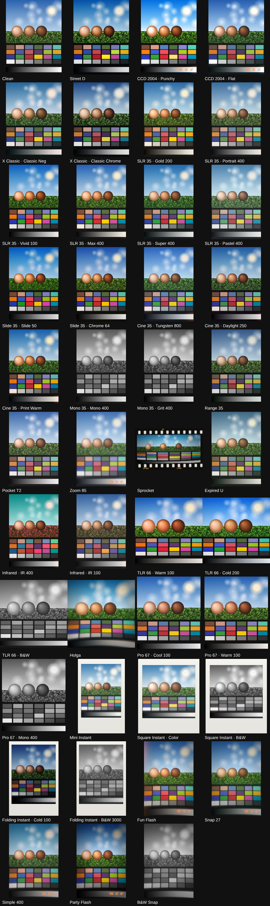

## Contents

1. [Cameras, profiles and options](#cameras-profiles-and-options)
2. [How a look is rendered](#how-a-look-is-rendered)
3. [Viewfinder, saved photo and editor](#viewfinder-saved-photo-and-editor)
4. [Settings reference](#settings-reference)
5. [Frames](#frames)
6. [Tuning looks](#tuning-looks)
7. [Limits](#limits)
8. [Camera catalog](#camera-catalog)
9. [References](#references)

## Cameras, profiles and options

The looks are organized the way Dazz Cam organizes its cameras: each one is a bundle of
color, a picture shape, lens defects and a few toggles, not only a color filter.

- A **camera** belongs to one of five categories: Digital, 135 (35mm film), 120 (medium
  format), Instant and Disposable. It has a name, the real camera it is inspired by, and a
  base look.
- A camera has one or more **profiles**, like films loaded into it: SLR 35 has Gold 200,
  Portrait 400, Vivid 100, Max 400, Super 400 and Pastel 400. A profile's look is merged
  over the camera's, key by key, so it only lists what it changes.
- A camera can offer **options**: Frame, Light Leak, Date and Jitter (gate weave), each
  with a default. Instant cameras also offer paper colors for the frame.
- The picker under the viewfinder shows category tabs, the category's cameras, then the
  selected camera's profiles, toggles and paper colors.
- Each camera remembers its own profile and options in `localStorage`
  (`pocket-film.camera-choices`), shared by the camera and the editor
  ([`useCameraSelection.ts`](../src/composables/useCameraSelection.ts)). The camera screen
  also remembers the selected camera.
- `CameraLibrary.resolve(camera, choice)` in [`library.ts`](../src/presets/library.ts) turns
  a camera and a choice into one flat look for the renderer. The same choice always gives
  the same object, so its color LUT is built once.
- Ids are `camera/profile`, e.g. `slr-35/gold`. The 19 presets from the first version
  (`gold-200`, `grit-400`, …) are aliases, so remembered looks and editor links keep
  working.

## How a look is rendered

One WebGL 2 renderer, [`FilmRenderer`](../src/render/FilmRenderer.ts), draws the viewfinder,
the editor preview and full-resolution photos. Effect sizes are relative to the picture's
short edge, so all three look alike. Shaders are in
[`gl/shaders.ts`](../src/render/gl/shaders.ts).

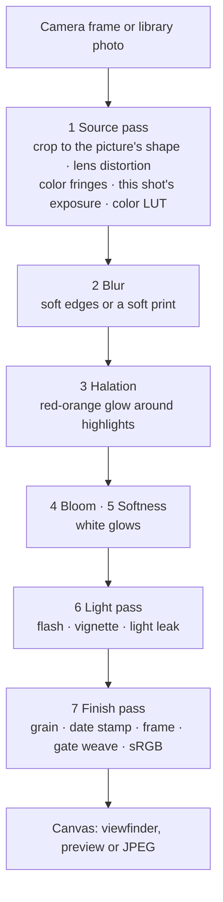

All intermediate textures are `SRGB8_ALPHA8`: the GPU turns sRGB into linear light on every
read and back on every write, so blurs and blends happen in linear light, as in a real
optical system. Passes skip themselves when a look doesn't use them.

1. **Source pass:** crops the source to the picture's shape (centered, covering it), then
   samples it through the lens.
   - Distortion moves each point by `1 + k·r²`, with `k = 0.25 × distortion` and `r` the
     distance from the center (1 at the corners). The result is scaled so the picture still
     fills the frame.
   - Chromatic aberration samples red a little further out and blue a little further in,
     growing with `r²`; nothing moves at the center.
   - The shot's exposure and white balance variation is applied as a linear gain.
   - Finally the look's 33×33×33 color LUT is applied (below).
2. **Blur:** a Gaussian blur mixed in toward the edges (`lens.edgeBlur`, from 25% of the way
   out) and/or everywhere (`lens.blur`).
3. **Halation:** the highlights above `threshold` (with a soft knee) are found at half size,
   blurred into a tight and a wide glow, tinted with `halation.color` (red-orange by
   default) and screen-blended over the picture. The tight and wide glows are about 0.4%
   and 2% of the short edge × `radius`.
4. **Bloom:** the same with a white glow and a lower threshold. **Softness** screen-blends a
   blurred copy of the whole picture, like a cheap plastic lens.
5. **Light pass:**
   - The flash brightens by `2^(0.5 × flash)`, tinted by `flashColor`, and falls off from
     10% of the short edge to the corners.
   - The vignette darkens from 30% of the short edge out, to `1 − 0.75 × vignette` at the
     corners.
   - The light leak is one to three glowing blobs along the left or right edge. Each fades
     from `color` through `edgeColor` to nothing and is screen-blended.
6. **Finish pass** (straight into the canvas):
   - Grain is applied with a soft-light blend from a 512×512 noise tile (three independent
     channels), weighted by tone.
   - The date stamp is drawn in the bottom-right corner of the picture.
   - The frame texture is composited around the picture; with jitter, picture and frame sit
     slightly off-center and crooked.
   - The result is encoded to sRGB.

### The color LUT

All color work is baked once per look into a 33³ 3D LUT by
[`ColorTransform`](../src/render/colorTransform.ts), so it costs one texture lookup per pixel
however many stages a look uses. For each LUT entry, in order:

1. **Exposure and white balance** in linear light (`temperature` scales red and blue by ±12%
   per unit, `tint` green by 8%).
2. **Channel matrix** (`matrix`), in linear light.
3. **Clipping** (`clip`): once the brightest channel passes a knee, the color bleaches
   toward white, like a small digital sensor.
4. **Highlight rolloff:** a soft shoulder in linear light.
5. **Film curve** (`filmCurve`), or the simpler `contrast` S-curve, in sRGB.
   - The film curve turns around mid-gray (sRGB 0.46) with its own slope per channel.
   - Its toe and shoulder set how gently shadows and highlights bend.
   - Different contrast per channel gives film's color crossover, e.g. bluer shadows and
     warmer highlights.
6. **Hue bands** (`hue`): each color is assigned a hue on the RGB color wheel, and the eight
   bands (red 0°, orange 30°, yellow 60°, green 120°, aqua 180°, blue 225°, purple 270°,
   magenta 315°) are interpolated smoothly.
   - Hue shifts rotate the color around the gray axis (Rodrigues' formula).
   - Saturation scales the distance from gray; lightness scales the color.
   - Everything fades out near gray, so neutrals never change.
7. **Saturation**, scaled further in the shadows (`shadowSaturation`) and highlights
   (`highlightSaturation`).
8. **Black and white** (`monochrome`) with channel weights (`monoMix`).
9. **Split toning** (`shadowTint`, `highlightTint`).
10. **Curves** (`master`, `red`, `green`, `blue`): monotone cubic (Fritsch–Carlson) curves
    through the given points, so they never overshoot.
11. **Fade:** lifts black to `fade`.

### Grain

- Grain is sized relative to the picture: `size` 1 is about one grain per 1500th of the
  short edge.
- `chroma` mixes from black-and-white grain (all channels the same) to independent grain per
  color layer. Black-and-white looks always get gray grain.
- `roughness` adds coarser clumps from another part of the tile.
- `response` sets the strength in the shadows, midtones and highlights. Negative film has
  almost no grain in the highlights; sensor noise is strongest in the shadows.
- Each shot's seed starts the tile at a different spot.

## Viewfinder, saved photo and editor

| Camera screen with SLR 35               | Mini Instant                                        | Holga                                 |
| --------------------------------------- | --------------------------------------------------- | ------------------------------------- |
| 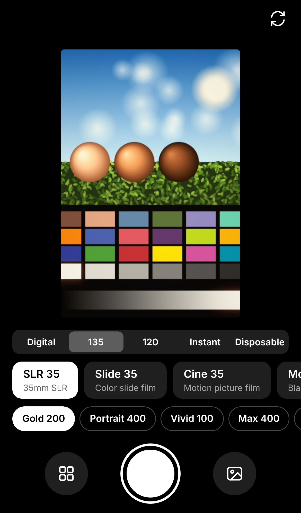 | 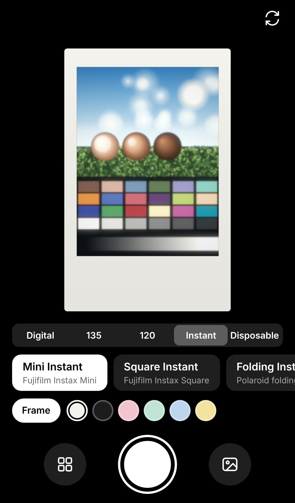 | 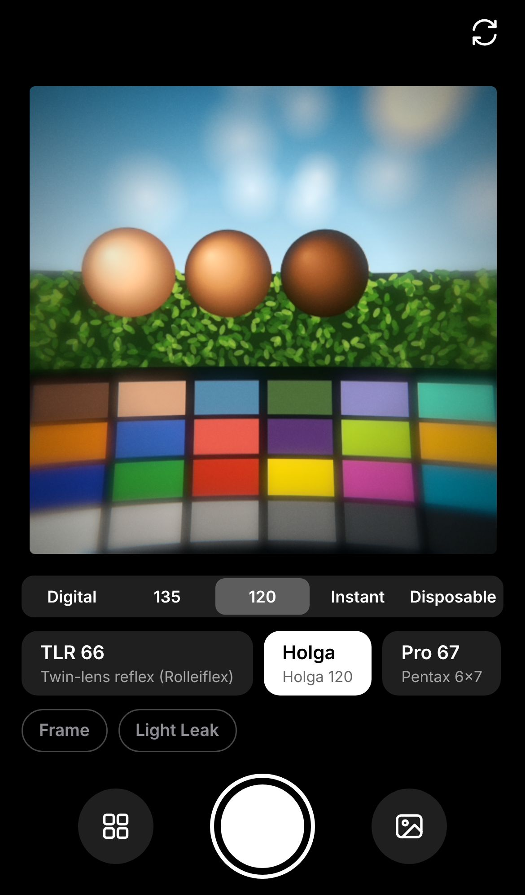 |

(The screenshots use the test scene as the camera's picture.)

**Viewfinder** ([`useCamera.ts`](../src/composables/useCamera.ts)):

- **Each video frame:** the hidden camera `<video>` is uploaded as a texture on every
  `requestVideoFrameCallback` (or `requestAnimationFrame` where that is missing) and
  rendered with the full pipeline into the viewfinder canvas.
- **Resolution:** the canvas renders at its CSS size × the device pixel ratio, capped at 2.
- **Shape:** the viewfinder takes the photo's shape, frame included (`framedAspect` in
  [`geometry.ts`](../src/render/geometry.ts)). Cameras without a shape of their own shoot
  3:4, like the phone.
- **Same seed as the shot:** the viewfinder renders with the next shot's seed, so its grain,
  light leak, frame number and gate weave are exactly what the photo will get. A new seed is
  picked after each shot.
- **Grain at screen size:** when a grain would be smaller than a pixel, as at viewfinder
  size, it is drawn weaker instead of coarser. That is how the full-size photo looks when
  shrunk to the same size, so the preview matches the photo.

**Taking a photo:**

1. **Capture:** Chrome on Android uses `ImageCapture.takePhoto` (full resolution, with the
   real flash). Elsewhere, including iPhone Safari, the current video frame is grabbed at
   the stream's highest resolution.
2. **Render:** [`encodePhoto`](../src/render/encode.ts) crops the frame to the camera's
   shape, adds the frame, and renders at full resolution, scaled down only to fit the
   browser's limits (16.7 megapixels and the GPU's largest texture).
3. **Save:** the result is encoded as JPEG (quality 0.9) with a thumbnail and saved to the
   in-app gallery.

**Editor** ([`EditorView.vue`](../src/views/EditorView.vue)):

- **Preview:** a library photo is decoded upright and previewed at 1600 px on the long edge.
  Saving renders the full-resolution photo with the same seed, so they match.
- **Shape:** the camera's shape turns to match a landscape photo, so a 2:3 camera crops a
  landscape photo to 3:2. Clean keeps the photo's own shape.
- **Original:** touch and hold the photo to see it without the look.

## Settings reference

Every field of a look is optional and defaults to "no change"
([`types.ts`](../src/presets/types.ts) has the full definitions).

### Color (`color`, baked into the LUT)

| Field                                     | Range                                                        | What it does                                                                                             |
| ----------------------------------------- | ------------------------------------------------------------ | -------------------------------------------------------------------------------------------------------- |
| `exposure`                                | stops                                                        | Brighter or darker, in linear light.                                                                     |
| `temperature`, `tint`                     | about −1…1                                                   | Warm/cool and magenta/green white balance.                                                               |
| `matrix`                                  | 9 numbers                                                    | Mixes channels, row by row (dye cross-talk, infrared swaps).                                             |
| `clip`                                    | 0…1                                                          | Digital highlight clipping that bleaches toward white.                                                   |
| `highlightRolloff`                        | 0…1                                                          | Soft shoulder instead of hard clipping.                                                                  |
| `filmCurve`                               | `contrast` 0.25…2, `toe` / `shoulder` 0…1, `channelContrast` | Film characteristic curve; replaces `contrast`.                                                          |
| `contrast`                                | −1…1                                                         | A simple S-curve for digital looks.                                                                      |
| `hue`                                     | per band: `hue` (degrees), `sat`, `lum` (−1…1)               | Changes near one hue; bands are `red`, `orange`, `yellow`, `green`, `aqua`, `blue`, `purple`, `magenta`. |
| `saturation`                              | 0…2                                                          | Overall saturation; 0 is gray.                                                                           |
| `shadowSaturation`, `highlightSaturation` | multipliers                                                  | Less (or more) color in the dark or bright tones.                                                        |
| `monochrome`, `monoMix`                   | bool, 3 weights                                              | Black and white with a channel mix (like a color filter on B&W film).                                    |
| `shadowTint`, `highlightTint`             | RGB offsets about ±0.1                                       | Split toning.                                                                                            |
| `curves`                                  | `master`, `red`, `green`, `blue`: `[[x, y], …]`              | Tone curves through points in 0…1.                                                                       |
| `fade`                                    | 0…0.3                                                        | Lifts black, for a faded print.                                                                          |

### Grain, lens and light

| Field                                   | What it does                                                                      |
| --------------------------------------- | --------------------------------------------------------------------------------- |
| `grain.intensity`, `size`               | Strength (0…1) and grain size (1 ≈ 35mm).                                         |
| `grain.chroma`, `roughness`, `response` | Color grain, clumping, and strength in shadows / mids / highlights.               |
| `lens.distortion`                       | −1…1: positive bulges (barrel), negative pinches (pincushion).                    |
| `lens.chromaticAberration`              | Red and blue fringes toward the edges.                                            |
| `lens.edgeBlur`, `lens.blur`            | Out-of-focus edges; a slightly soft picture overall.                              |
| `softness`                              | Glow from a cheap plastic lens.                                                   |
| `halation`                              | `intensity`, `radius`, `color`, `threshold`: glow around highlights.              |
| `bloom`                                 | `intensity`, `radius`, `threshold`: white glow around bright areas.               |
| `flash`, `flashColor`                   | On-camera flash: bright center that falls off; colored for a filter.              |
| `vignette`                              | Darker corners.                                                                   |
| `lightLeak`                             | `intensity`, `color` (core), `edgeColor`, `chance` (share of shots that get one). |
| `variation`                             | `exposure` (stops) and `temperature` that change from shot to shot.               |

### Shape and finish

| Field                         | What it does                                                               |
| ----------------------------- | -------------------------------------------------------------------------- |
| `aspect`                      | `[width, height]` of the picture held upright, e.g. `[2, 3]`.              |
| `frame`                       | `style`, `color` (CSS), `text` (edge print). See [Frames](#frames).        |
| `jitter`                      | Gate weave: the film sits slightly off-center and crooked. Needs a frame.  |
| `dateStamp`, `dateStampColor` | Seven-segment date imprint `'YY M D` in the picture's bottom-right corner. |

### Camera fields

| Field                                  | What it does                                                                                                        |
| -------------------------------------- | ------------------------------------------------------------------------------------------------------------------- |
| `id`, `name`, `inspiredBy`, `category` | Identity; the category is `digital`, `film135`, `film120`, `instant` or `disposable`.                               |
| `look`                                 | The base look every profile starts from.                                                                            |
| `profiles`                             | `id`, `name`, `inspiredBy`, `notes` (what it aims for) and a `look` merged over the base.                           |
| `options`                              | Offered toggles and their defaults: `frame`, `lightLeak`, `dateStamp`, `jitter`. Each needs its effect in the look. |
| `frameColors`                          | `name` and `color` of paper colors for instant frames; the first is the default.                                    |
| `aliases` (top level)                  | Old ids → `camera/profile`.                                                                                         |

## Frames

Frames are drawn with Canvas 2D ([`frameImage.ts`](../src/render/frameImage.ts)), once per
size, and composited in the finish pass. Border widths are relative to the picture's short
edge (`frameInsets` in [`geometry.ts`](../src/render/geometry.ts)) and come from the real
formats:

| Style           | Border (left, right, top, bottom)      | From                                                                                                                 |
| --------------- | -------------------------------------- | -------------------------------------------------------------------------------------------------------------------- |
| `instax-mini`   | 8.7%, 8.7%, 13%, 39%                   | Instax Mini: 54×86 mm print, 46×62 mm picture                                                                        |
| `instax-square` | 8%, 8%, 11.5%, 29%                     | Instax Square: 72×86 mm print, 62×62 mm picture                                                                      |
| `instant-white` | 6%, 6%, 7.5%, 27%                      | Polaroid 600: about 88×107 mm print, 79×77 mm picture                                                                |
| `film-35`       | 23% on the long sides, 7% on the short | 35mm film is 35 mm wide around a 24×36 mm frame: 5.5 mm rebates with KS perforations (2.794×1.981 mm, 4.75 mm pitch) |
| `film-120`      | 6%, with 11% on the edge-print side    | 120 film is about 61 mm wide around a 56 mm picture                                                                  |
| `slide-mount`   | 26% all round                          | A 50×50 mm slide mount                                                                                               |

- 35mm frames have light sprocket holes at the real size and pitch, and orange edge print
  (the profile's `frame.text` and a seeded frame number such as `▸ 12A`).
- Instant frames have a faint sheen and a thin shadow where the picture meets the paper.
- The Polaroid border was sized from a 79×79 mm picture; Polaroid's own figure is 79×77 mm,
  a difference of under 1% of the border.

## Tuning looks

- **Tuner:** `npm run dev`, then open `/tune.html`.
  - Pick a look and drop in a photo (or use the test scene).
  - Edit the look's JSON and see the result live; tick **Original** to compare.
  - **Copy JSON** puts it on the clipboard to paste back into `cameras.json`.
- **Test scene** ([`testScene.ts`](../src/testing/testScene.ts)): a sky with clouds, a bright
  lamp (for halation and bloom), foliage, three lit skin-tone spheres, the 24 ColorChecker
  patches and a gray ramp. It is drawn at each look's shape.
- **Contact sheet:** `npm run test:e2e` writes `contact-sheet/presets.png`, every profile
  on the test scene; CI uploads it as an artifact.
- **This document:** `npm run docs:looks` re-renders the samples and the catalog below;
  `npm run docs:looks -- --screenshots` also retakes the camera screen screenshots.

## Limits

- The looks were tuned by eye on the synthetic test scene, from the descriptions in the
  references below. They are not fitted to scans of real film or to the manufacturers' data
  sheets, and should be checked against real photos.
- Speed was measured with a software renderer only (SwiftShader); check the viewfinder on
  real phones.
- Photos are saved as sRGB JPEG, without the source's EXIF data.

## Camera catalog

Generated by `npm run docs:looks`. Each sample shows the look with its default options on
the test scene, with the same seed for every look.

<!-- looks:start -->

### Digital

#### Clean

Phone shape (3:4)

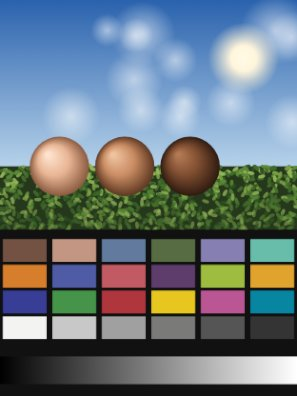

`clean/default`

- No changes.

 

#### Street D

Inspired by Ricoh GR digital · phone shape (3:4)

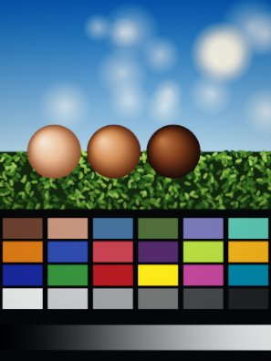

`street-d/default`

- **Aiming for:** Cool tones, deep rich blacks, deep blues and reds, lighter yellows, soft highlight rolloff.
- **Color:** contrast +0.28, saturation 1.05, temperature -0.12, highlight rolloff 0.6, hue bands: red sat +0.15 lum -0.15; yellow sat -0.1 lum +0.35; green sat -0.1; blue hue -5° sat +0.2 lum -0.2, shadow tint -0.01 / 0 / 0.012, curves: master
- **Grain:** intensity 0.1, size 0.6, color 0.7, clumping 0, strength in shadows / mids / highlights 1 / 0.6 / 0.2
- **Light:** vignette 0.15

 

#### CCD 2004

Inspired by Early-2000s CCD point-and-shoot · phone shape (3:4) · options: Date (on)

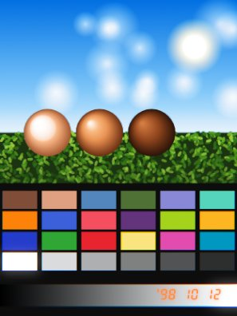

**Punchy** (`ccd-2004/punchy`)

- **Aiming for:** Harsh contrast and punchy color. Highlights clip easily and bleach to white.
- **Color:** exposure +0.15 stops, contrast +0.38, saturation 1.25, temperature -0.12, tint -0.02, highlight clipping 0.85, hue bands: red sat +0.1; blue hue -6° sat +0.15
- **Grain:** intensity 0.14, size 0.5, color 1, clumping 0, strength in shadows / mids / highlights 1.3 / 0.6 / 0.15
- **Lens:** color fringes 0.45
- **Light:** bloom 0.12

 

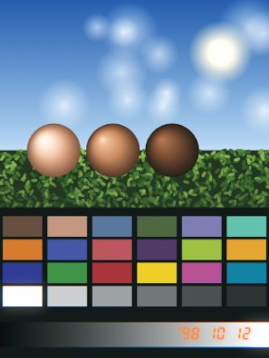

**Flat** (`ccd-2004/flat`)

- **Aiming for:** Flatter contrast with murky, turquoise shadows.
- **Color:** exposure +0.15 stops, contrast +0.05, saturation 0.95, temperature -0.12, tint -0.02, fade 0.02, highlight clipping 0.45, shadow tint -0.035 / 0.02 / 0.015, curves: master
- **Grain:** intensity 0.14, size 0.5, color 1, clumping 0, strength in shadows / mids / highlights 1.3 / 0.6 / 0.15
- **Lens:** color fringes 0.45
- **Light:** bloom 0.12

 

#### X Classic

Inspired by Fujifilm X100 · phone shape (3:4)

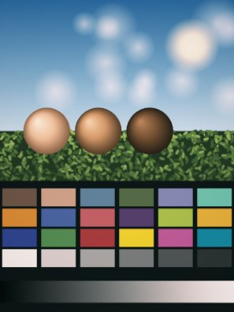

**Classic Neg** (`x-classic/classic-neg`)

- **Inspired by:** Fujifilm Classic Negative
- **Aiming for:** Earthy and bright. Soft, peachy highlights over cool undertones; yellowish skin.
- **Color:** contrast +0.28, saturation 0.9, temperature +0.05, tint -0.03, fade 0.02, highlight rolloff 0.5, hue bands: red sat -0.05; orange hue +4° sat -0.05; green hue -8° sat -0.25 lum -0.1; blue hue -8° sat -0.1, shadow tint -0.02 / 0.01 / 0.02, highlight tint 0.03 / 0.012 / -0.015, curves: red, green
- **Grain:** intensity 0.07, size 0.6, color 0.3, clumping 0, strength in shadows / mids / highlights 1 / 0.7 / 0.3
- **Light:** vignette 0.12

 

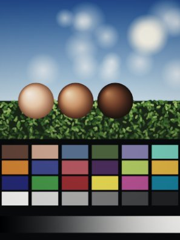

**Classic Chrome** (`x-classic/classic-chrome`)

- **Inspired by:** Fujifilm Classic Chrome
- **Aiming for:** Muted, documentary color with firm shadows and calm blues.
- **Color:** exposure -0.05 stops, contrast +0.25, saturation 0.75, tint -0.02, highlight rolloff 0.3, hue bands: red sat -0.1; yellow sat -0.2; blue sat -0.1 lum -0.15, shadow tint -0.01 / 0 / 0.01, highlight tint 0.01 / 0.01 / 0, curves: master
- **Grain:** intensity 0.07, size 0.6, color 0.3, clumping 0, strength in shadows / mids / highlights 1 / 0.7 / 0.3
- **Light:** vignette 0.12

 

### 135 film

#### SLR 35

Inspired by 35mm SLR · 2:3 picture · frame: 35mm film strip with sprocket holes · options: Frame (off), Jitter (off)

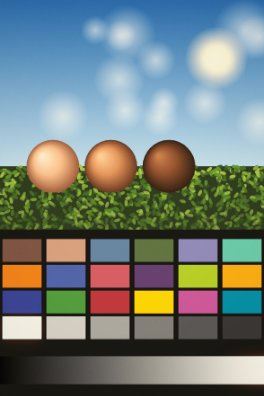

**Gold 200** (`slr-35/gold`)

- **Inspired by:** Kodak Gold 200
- **Aiming for:** Warm and golden, saturated yellows and oranges, soft highlights.
- **Color:** exposure +0.1 stops, film curve: contrast 1.15, toe 0.6, shoulder 0.7, per channel 1 / 1 / 0.92, saturation 1.1, shadow saturation 0.85, temperature +0.3, tint +0.03, fade 0.025, highlight rolloff 0.5, hue bands: orange sat +0.1; yellow hue -3° sat +0.15 lum +0.1; green hue -12° sat -0.05; blue hue -5° sat -0.05, shadow tint 0.01 / 0 / -0.02, highlight tint 0.03 / 0.02 / -0.03
- **Grain:** intensity 0.22, size 1, color 0.35, clumping 0.2, strength in shadows / mids / highlights 1 / 0.9 / 0.35
- **Light:** halation 0.15 (radius 1, from brightness 0.7), vignette 0.1

 

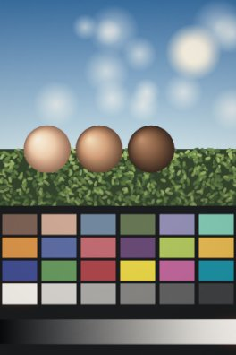

**Portrait 400** (`slr-35/portrait`)

- **Inspired by:** Kodak Portra 400
- **Aiming for:** Low contrast and warm-neutral, with smooth skin and pastel greens.
- **Color:** exposure +0.15 stops, film curve: contrast 0.95, toe 0.8, shoulder 0.9, per channel 1 / 1 / 0.95, saturation 0.9, highlight saturation 0.85, temperature +0.12, tint +0.03, fade 0.035, highlight rolloff 0.7, hue bands: red sat -0.08; orange hue +2° sat -0.08 lum +0.08; green hue -10° sat -0.2; blue hue -6° sat -0.1, shadow tint -0.005 / 0.005 / 0.012, highlight tint 0.02 / 0.01 / -0.01
- **Grain:** intensity 0.18, size 1, color 0.35, clumping 0.2, strength in shadows / mids / highlights 1 / 0.9 / 0.35
- **Light:** halation 0.15 (radius 1, from brightness 0.7), vignette 0.1

 

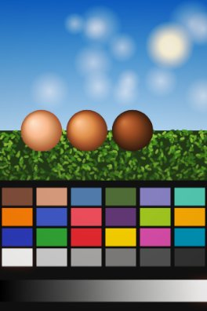

**Vivid 100** (`slr-35/vivid`)

- **Inspired by:** Kodak Ektar 100
- **Aiming for:** Punchy saturation, deep blues and reds, very fine grain.
- **Color:** film curve: contrast 1.3, toe 0.4, shoulder 0.5, saturation 1.25, temperature +0.05, highlight rolloff 0.3, hue bands: red sat +0.15; orange sat +0.1; green sat +0.05; blue hue -4° sat +0.15 lum -0.1
- **Grain:** intensity 0.1, size 0.8, color 0.35, clumping 0.2, strength in shadows / mids / highlights 1 / 0.9 / 0.35
- **Light:** halation 0.15 (radius 1, from brightness 0.7), vignette 0.1

 

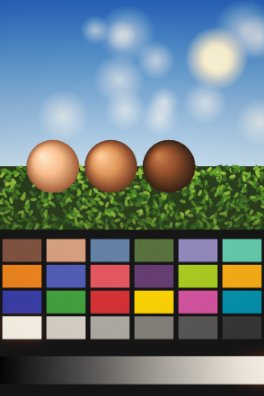

**Max 400** (`slr-35/max`)

- **Inspired by:** Kodak UltraMax 400
- **Aiming for:** Warm, saturated and contrasty, with visible grain.
- **Color:** exposure +0.05 stops, film curve: contrast 1.25, toe 0.5, shoulder 0.6, per channel 1 / 1 / 0.95, saturation 1.15, temperature +0.28, fade 0.02, highlight rolloff 0.4, hue bands: red sat +0.1; yellow sat +0.1, highlight tint 0.03 / 0.01 / -0.03
- **Grain:** intensity 0.3, size 1.1, color 0.35, clumping 0.2, strength in shadows / mids / highlights 1 / 0.9 / 0.35
- **Light:** halation 0.15 (radius 1, from brightness 0.7), vignette 0.1

 

**Super 400** (`slr-35/super`)

- **Inspired by:** Fujifilm Superia 400
- **Aiming for:** Cool and a little green, with lively greens and magenta-leaning reds.
- **Color:** film curve: contrast 1.2, toe 0.5, shoulder 0.6, per channel 1.02 / 1 / 0.95, saturation 1.1, temperature -0.05, tint -0.1, fade 0.03, highlight rolloff 0.4, hue bands: red hue -3° sat +0.05; green hue +8° sat +0.1; blue hue -6°, shadow tint -0.02 / 0.015 / 0.01
- **Grain:** intensity 0.28, size 1, color 0.35, clumping 0.2, strength in shadows / mids / highlights 1 / 0.9 / 0.35
- **Light:** halation 0.15 (radius 1, from brightness 0.7), vignette 0.1

 

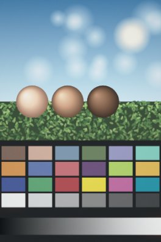

**Pastel 400** (`slr-35/pastel`)

- **Inspired by:** Fujifilm Pro 400H
- **Aiming for:** Bright and airy: mint greens, cyan skies, low contrast.
- **Color:** exposure +0.3 stops, film curve: contrast 0.9, toe 0.8, shoulder 0.9, saturation 0.82, temperature -0.05, tint -0.06, fade 0.07, highlight rolloff 0.8, hue bands: orange sat -0.1 lum +0.05; green hue +15° sat -0.1 lum +0.1; blue hue -10° sat -0.1 lum +0.1, shadow tint -0.01 / 0.01 / 0.02, highlight tint 0 / 0.01 / 0.01
- **Grain:** intensity 0.18, size 1, color 0.35, clumping 0.2, strength in shadows / mids / highlights 1 / 0.9 / 0.35
- **Light:** halation 0.15 (radius 1, from brightness 0.7), vignette 0.1

 

#### Slide 35

Inspired by Color slide film · 2:3 picture · frame: slide mount · options: Frame (off)

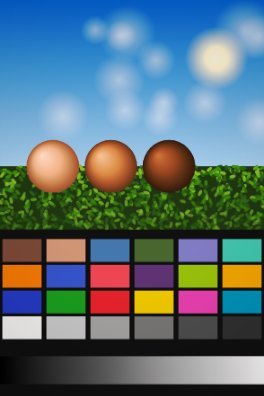

**Slide 50** (`slide-35/velvia`)

- **Inspired by:** Fujifilm Velvia 50
- **Aiming for:** Very saturated, deep blacks, rich greens and blues.
- **Color:** exposure -0.1 stops, film curve: contrast 1.45, toe 0.2, shoulder 0.4, saturation 1.4, temperature +0.05, tint +0.05, highlight rolloff 0.2, hue bands: red sat +0.1; green sat +0.15 lum -0.1; blue hue -6° sat +0.15 lum -0.1; magenta sat +0.1
- **Grain:** intensity 0.08, size 0.7, color 0.3, clumping 0, strength in shadows / mids / highlights 0.8 / 1 / 0.5
- **Light:** vignette 0.15

 

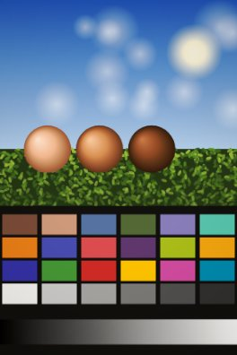

**Chrome 64** (`slide-35/kodachrome`)

- **Inspired by:** Kodak Kodachrome 64
- **Aiming for:** Warm, dense reds and yellows, deep blue skies, firm contrast.
- **Color:** film curve: contrast 1.35, toe 0.3, shoulder 0.5, saturation 1.2, temperature +0.18, highlight rolloff 0.3, hue bands: red hue +3° sat +0.15 lum -0.1; yellow hue -5° sat +0.1; green hue -10° sat -0.1 lum -0.05; blue hue +4° sat +0.05 lum -0.15, shadow tint 0 / -0.005 / -0.015
- **Grain:** intensity 0.12, size 0.8, color 0.3, clumping 0, strength in shadows / mids / highlights 0.8 / 1 / 0.5
- **Light:** vignette 0.15

 

#### Cine 35

Inspired by Motion picture film · 2:3 picture · frame: 35mm film strip with sprocket holes · options: Frame (off), Jitter (off)

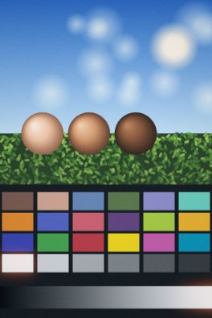

**Tungsten 800** (`cine-35/tungsten`)

- **Inspired by:** CineStill 800T
- **Aiming for:** Cool, tungsten-balanced color with strong red halos around lights.
- **Color:** exposure +0.1 stops, film curve: contrast 1.15, toe 0.6, shoulder 0.7, saturation 1.05, temperature -0.75, tint +0.05, fade 0.04, highlight rolloff 0.6, shadow tint -0.02 / 0.01 / 0.03, highlight tint 0.02 / 0 / -0.01
- **Grain:** intensity 0.35, size 1.2, color 0.4, clumping 0.3, strength in shadows / mids / highlights 1 / 0.9 / 0.3
- **Light:** halation 0.85 (radius 1.2, from brightness 0.6), vignette 0.12

 

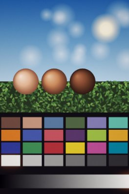

**Daylight 250** (`cine-35/daylight`)

- **Inspired by:** Daylight cine negative
- **Aiming for:** Vibrant but bleached, cool greens and purple-leaning shadows. A little dark.
- **Color:** exposure -0.15 stops, film curve: contrast 1.25, toe 0.5, shoulder 0.8, per channel 1.02 / 1 / 0.95, highlight saturation 0.8, temperature +0.05, hue bands: orange sat +0.05; green hue +12° sat -0.15; blue hue -5° sat +0.05, shadow tint 0.008 / -0.01 / 0.02
- **Grain:** intensity 0.25, size 1, color 0.4, clumping 0.2, strength in shadows / mids / highlights 1 / 0.9 / 0.3
- **Light:** halation 0.5 (radius 1.1, from brightness 0.62), vignette 0.12

 

**Print Warm** (`cine-35/print`)

- **Inspired by:** Cine print film
- **Aiming for:** Warm, saturated print tones over cool shadows.
- **Color:** exposure -0.1 stops, film curve: contrast 1.35, toe 0.4, shoulder 0.6, saturation 1.15, temperature +0.25, tint +0.02, hue bands: red sat +0.1 lum -0.05; orange sat +0.1; aqua hue +10° sat -0.1; blue hue -8°, shadow tint -0.01 / 0 / 0.02, highlight tint 0.03 / 0.015 / -0.02
- **Grain:** intensity 0.25, size 1, color 0.4, clumping 0.2, strength in shadows / mids / highlights 1 / 0.9 / 0.3
- **Light:** halation 0.5 (radius 1.1, from brightness 0.62), vignette 0.12

 

#### Mono 35

Inspired by Black and white film · 2:3 picture · frame: 35mm film strip with sprocket holes · options: Frame (off), Jitter (off)

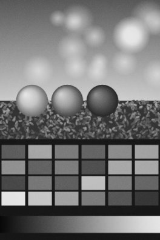

**Mono 400** (`mono-35/hp5`)

- **Inspired by:** Ilford HP5 Plus 400
- **Aiming for:** Classic, forgiving black and white with moderate contrast.
- **Color:** film curve: contrast 1.15, toe 0.6, shoulder 0.7, fade 0.03, highlight rolloff 0.5, black and white (mix 0.3 / 0.59 / 0.11)
- **Grain:** intensity 0.4, size 1.1, color 0, clumping 0.3, strength in shadows / mids / highlights 0.9 / 1 / 0.5
- **Light:** vignette 0.1

 

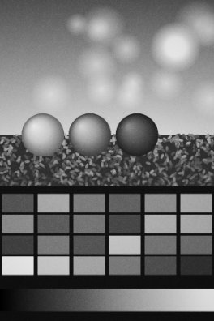

**Grit 400** (`mono-35/trix`)

- **Inspired by:** Kodak Tri-X 400
- **Aiming for:** Gritty, contrasty black and white with coarse grain.
- **Color:** exposure +0.05 stops, film curve: contrast 1.45, toe 0.35, shoulder 0.5, highlight rolloff 0.3, black and white (mix 0.25 / 0.65 / 0.1)
- **Grain:** intensity 0.5, size 1.3, color 0, clumping 0.5, strength in shadows / mids / highlights 0.9 / 1 / 0.5
- **Light:** vignette 0.2

 

#### Range 35

Inspired by Classic rangefinder · 2:3 picture · options: Light Leak (off)

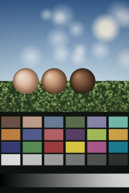

`range-35/default`

- **Aiming for:** Desaturated with greenish undertones and a soft highlight rolloff.
- **Color:** film curve: contrast 1.1, toe 0.6, shoulder 0.85, saturation 0.8, temperature +0.02, tint -0.08, highlight rolloff 0.7, hue bands: orange sat -0.05; green hue -6° sat -0.15; blue sat -0.2, shadow tint -0.01 / 0.015 / 0
- **Grain:** intensity 0.22, size 1, color 0.3, clumping 0.2, strength in shadows / mids / highlights 1 / 0.9 / 0.35
- **Light:** vignette 0.18, light leak 0.45

 

#### Pocket T2

Inspired by Contax T2 · 2:3 picture · options: Light Leak (off)

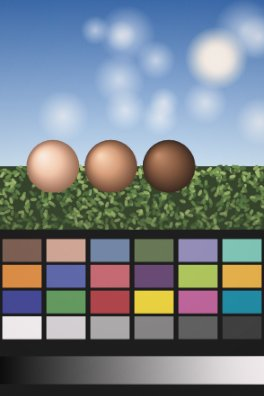

`pocket-t2/default`

- **Aiming for:** Washed out, with pink-leaning highlights.
- **Color:** exposure +0.15 stops, film curve: contrast 1, toe 0.8, shoulder 0.9, saturation 0.88, tint +0.04, fade 0.05, highlight rolloff 0.6, hue bands: orange lum +0.05; green hue -5° sat -0.15, highlight tint 0.025 / 0 / 0.012
- **Grain:** intensity 0.2, size 1, color 0.35, clumping 0.2, strength in shadows / mids / highlights 1 / 0.9 / 0.35
- **Light:** vignette 0.08, light leak 0.4

 

#### Zoom 85

Inspired by Canon Sure Shot zoom · 2:3 picture · options: Date (on)

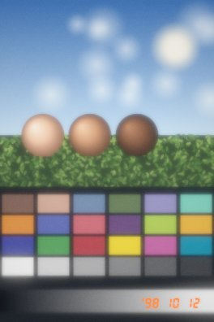

`zoom-85/default`

- **Aiming for:** Hazy, noisy and almost out of focus, with lifted, cold shadows.
- **Color:** exposure +0.1 stops, film curve: contrast 1, toe 0.9, shoulder 0.8, saturation 0.92, temperature +0.05, fade 0.07, highlight rolloff 0.5, shadow tint -0.02 / 0 / 0.035
- **Grain:** intensity 0.38, size 1.2, color 0.6, clumping 0.3, strength in shadows / mids / highlights 1.2 / 1 / 0.4
- **Lens:** soft edges 0.5, overall blur 0.25, glow 0.35
- **Light:** bloom 0.3, vignette 0.15

 

#### Sprocket

Inspired by Lomography Sprocket Rocket · 9:4 picture · frame: 35mm film strip with sprocket holes · options: Frame (on), Jitter (on)

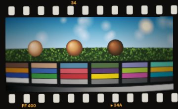

`sprocket/default`

- **Aiming for:** Panoramic and grungy: high contrast, cyan blues, yellowish skin, bulging lens and heavy vignette.
- **Color:** film curve: contrast 1.45, toe 0.35, shoulder 0.5, per channel 1.05 / 1 / 0.9, saturation 1.1, temperature +0.08, fade 0.03, hue bands: orange hue +5° sat +0.05; aqua sat +0.1; blue hue -15° sat +0.1, shadow tint -0.01 / 0.01 / 0.01
- **Grain:** intensity 0.35, size 1.2, color 0.4, clumping 0.4, strength in shadows / mids / highlights 1 / 0.9 / 0.4
- **Lens:** barrel distortion 0.5, soft edges 0.3
- **Light:** vignette 0.55

 

#### Expired U

Inspired by Expired film in a 35mm SLR · 2:3 picture · options: Light Leak (off)

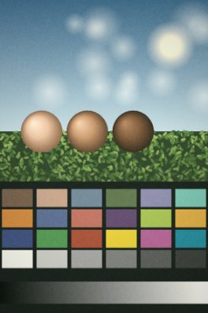

`expired-u/default`

- **Aiming for:** Nostalgic, expired look: green-leaning, orange reds, strong coarse grain.
- **Color:** exposure +0.1 stops, film curve: contrast 1.05, toe 0.8, shoulder 0.7, per channel 1 / 0.95 / 1.08, saturation 0.85, tint -0.15, fade 0.06, hue bands: red hue +12° sat +0.05; blue hue -10° sat -0.3, shadow tint -0.01 / 0.03 / 0, highlight tint 0.02 / 0.02 / -0.03
- **Grain:** intensity 0.55, size 1.4, color 0.5, clumping 0.7, strength in shadows / mids / highlights 1 / 1 / 0.6
- **Light:** vignette 0.25, light leak 0.4

 

#### Infrared

Inspired by Infrared color film · 2:3 picture

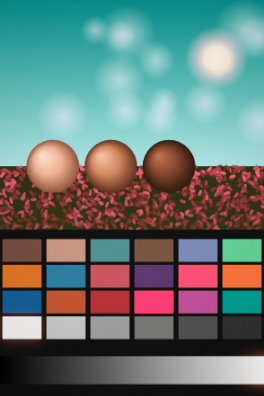

**IR 400** (`infrared/ir400`)

- **Aiming for:** Teals, oranges, reds and pinks: yellows and light greens turn pink, foliage red, blues cyan.
- **Color:** film curve: contrast 1.15, toe 0.6, shoulder 0.6, saturation 1.1, hue bands: orange hue -5°; yellow hue -80° sat +0.2 lum +0.1; green hue -110° sat +0.3 lum +0.3; aqua hue -10°; blue hue -40° sat +0.1
- **Grain:** intensity 0.3, size 1.1, color 0.3, clumping 0, strength in shadows / mids / highlights 1 / 0.9 / 0.4
- **Light:** halation 0.4 (radius 1, from brightness 0.7), vignette 0.15

 

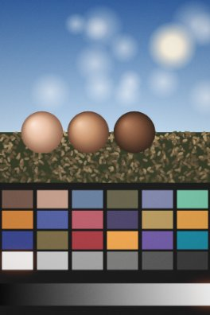

**IR 100** (`infrared/ir100`)

- **Aiming for:** Faded browns, oranges and blues: yellows and greens turn brown or orange, pinks and purples dark blue.
- **Color:** film curve: contrast 1.1, toe 0.7, shoulder 0.7, saturation 0.9, fade 0.05, hue bands: yellow hue -25° sat -0.2; green hue -80° sat -0.3 lum -0.1; purple hue -30° lum -0.2; magenta hue -70° lum -0.3
- **Grain:** intensity 0.3, size 1.1, color 0.3, clumping 0, strength in shadows / mids / highlights 1 / 0.9 / 0.4
- **Light:** halation 0.4 (radius 1, from brightness 0.7), vignette 0.15

 

### 120 film

#### TLR 66

Inspired by Twin-lens reflex (Rolleiflex) · 1:1 picture · frame: 120 film edge · options: Frame (off)

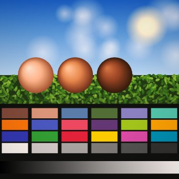

**Warm 100** (`tlr-66/warm`)

- **Aiming for:** Oversaturated and warm, with pinkish tones.
- **Color:** film curve: contrast 1.2, toe 0.6, shoulder 0.7, saturation 1.3, temperature +0.22, tint +0.06, hue bands: red hue -4° sat +0.1; orange hue -3° sat +0.05, highlight tint 0.02 / 0 / 0
- **Grain:** intensity 0.14, size 0.7, color 0.3, clumping 0, strength in shadows / mids / highlights 1 / 0.9 / 0.35
- **Light:** vignette 0.18

 

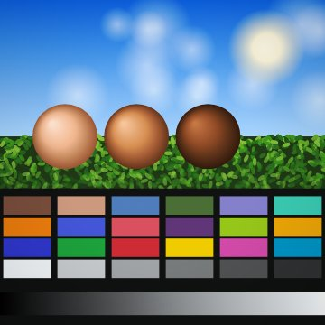

**Cold 200** (`tlr-66/cold`)

- **Aiming for:** Oversaturated and cold, with plasticky color.
- **Color:** film curve: contrast 1.25, toe 0.5, shoulder 0.5, saturation 1.3, temperature -0.25, tint -0.03, highlight clipping 0.2, hue bands: green hue +10° sat +0.1; aqua sat +0.2; blue sat +0.2
- **Grain:** intensity 0.14, size 0.7, color 0.3, clumping 0, strength in shadows / mids / highlights 1 / 0.9 / 0.35
- **Light:** vignette 0.18

 

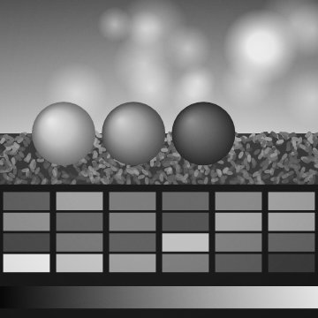

**B&W** (`tlr-66/bw`)

- **Aiming for:** Soft, low-contrast black and white.
- **Color:** film curve: contrast 0.9, toe 0.9, shoulder 0.9, fade 0.04, black and white (mix 0.3 / 0.6 / 0.1)
- **Grain:** intensity 0.2, size 0.7, color 0.3, clumping 0.3, strength in shadows / mids / highlights 0.9 / 1 / 0.5
- **Light:** vignette 0.18

 

#### Holga

Inspired by Holga 120 · 1:1 picture · frame: 120 film edge · options: Frame (off), Light Leak (off)

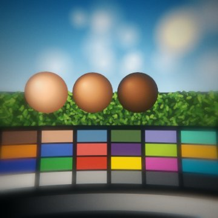

`holga/default`

- **Aiming for:** Teal and orange with orange reds, pinched lens, blurry edges, heavy vignette.
- **Color:** film curve: contrast 1.3, toe 0.5, shoulder 0.6, per channel 1.05 / 1 / 0.92, saturation 1.15, temperature +0.08, hue bands: red hue +10° sat +0.1; aqua sat +0.15; blue hue -12°, shadow tint -0.025 / 0.01 / 0.02, highlight tint 0.03 / 0.01 / -0.03
- **Grain:** intensity 0.25, size 0.9, color 0.3, clumping 0.3, strength in shadows / mids / highlights 1 / 0.9 / 0.4
- **Lens:** pincushion distortion 0.6, color fringes 0.3, soft edges 0.85, glow 0.15
- **Light:** vignette 0.75, light leak 0.5

 

#### Pro 67

Inspired by Pentax 6×7 · 6:7 picture · frame: 120 film edge · options: Frame (off)

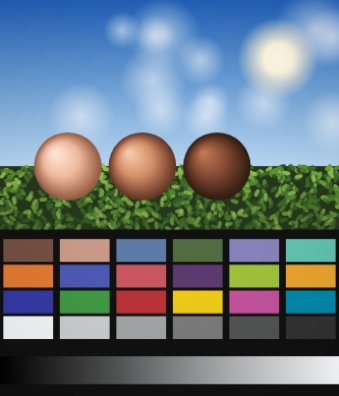

**Cool 100** (`pro-67/cool`)

- **Aiming for:** Cool overtones with pinkish skin.
- **Color:** film curve: contrast 1.15, toe 0.6, shoulder 0.8, saturation 1.05, temperature -0.12, tint +0.04, hue bands: orange hue -5° sat -0.05 lum +0.05; blue sat +0.05
- **Grain:** intensity 0.12, size 0.7, color 0.3, clumping 0, strength in shadows / mids / highlights 1 / 0.9 / 0.35
- **Light:** vignette 0.1

 

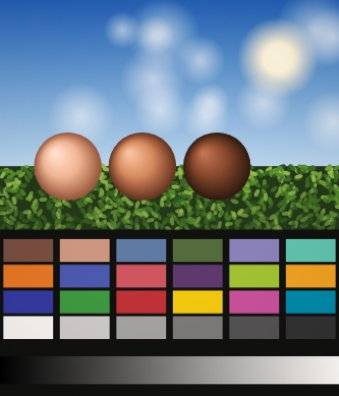

**Warm 100** (`pro-67/warm`)

- **Aiming for:** Warm overtones with pinkish skin.
- **Color:** film curve: contrast 1.15, toe 0.6, shoulder 0.8, saturation 1.1, temperature +0.2, tint +0.05, hue bands: orange hue -4°
- **Grain:** intensity 0.12, size 0.7, color 0.3, clumping 0, strength in shadows / mids / highlights 1 / 0.9 / 0.35
- **Light:** vignette 0.1

 

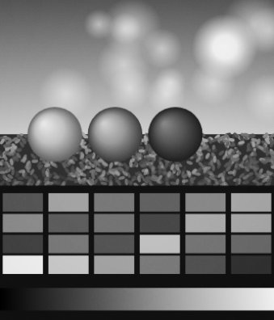

**Mono 400** (`pro-67/bw`)

- **Aiming for:** Standard black and white.
- **Color:** film curve: contrast 1.2, toe 0.6, shoulder 0.7, black and white (mix 0.25 / 0.65 / 0.1)
- **Grain:** intensity 0.25, size 0.7, color 0.3, clumping 0.3, strength in shadows / mids / highlights 0.9 / 1 / 0.5
- **Light:** vignette 0.1

 

### Instant

#### Mini Instant

Inspired by Fujifilm Instax Mini · 3:4 picture · frame: Instax Mini print · options: Frame (on) · paper colors: White, Black, Pink, Mint, Sky, Lemon

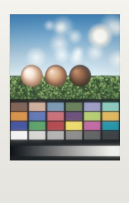

`mini-instant/default`

- **Aiming for:** Bleached, nostalgic instant color, slightly soft.
- **Color:** exposure +0.2 stops, film curve: contrast 1.1, toe 0.7, shoulder 0.4, saturation 0.85, highlight saturation 0.6, temperature +0.05, tint -0.03, fade 0.05, highlight clipping 0.3, hue bands: green hue +8° sat -0.1; blue hue -8° lum +0.1, shadow tint -0.01 / 0.01 / 0.025, highlight tint 0.02 / 0.02 / 0
- **Grain:** intensity 0.12, size 0.8, color 0.3, clumping 0, strength in shadows / mids / highlights 1 / 0.9 / 0.35
- **Lens:** soft edges 0.2, overall blur 0.35, glow 0.2
- **Light:** vignette 0.12

 

#### Square Instant

Inspired by Fujifilm Instax Square · 1:1 picture · frame: Instax Square print · options: Frame (on), Light Leak (off) · paper colors: White, Black, Pink, Mint, Sky, Lemon

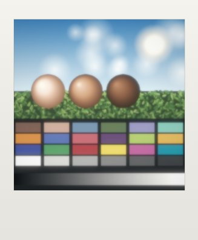

**Color** (`square-instant/color`)

- **Aiming for:** Bleached, nostalgic instant color, slightly soft.
- **Color:** exposure +0.2 stops, film curve: contrast 1.1, toe 0.7, shoulder 0.4, saturation 0.85, highlight saturation 0.6, temperature +0.05, tint -0.03, fade 0.05, highlight clipping 0.3, hue bands: green hue +8° sat -0.1; blue hue -8° lum +0.1, shadow tint -0.01 / 0.01 / 0.025, highlight tint 0.02 / 0.02 / 0
- **Grain:** intensity 0.12, size 0.8, color 0.3, clumping 0, strength in shadows / mids / highlights 1 / 0.9 / 0.35
- **Lens:** soft edges 0.2, overall blur 0.35, glow 0.2
- **Light:** vignette 0.12, light leak 0.45

 

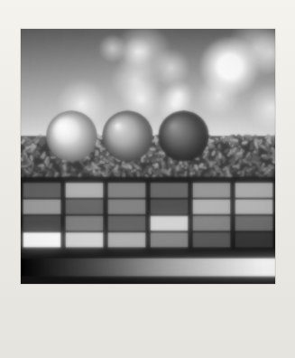

**B&W** (`square-instant/bw`)

- **Aiming for:** Black and white with clipped highlights.
- **Color:** exposure +0.15 stops, film curve: contrast 1.3, toe 0.5, shoulder 0.1, highlight clipping 0.6, black and white (mix 0.3 / 0.59 / 0.11)
- **Grain:** intensity 0.12, size 0.8, color 0.3, clumping 0, strength in shadows / mids / highlights 1 / 0.9 / 0.35
- **Lens:** soft edges 0.2, overall blur 0.35, glow 0.2
- **Light:** vignette 0.12, light leak 0.45

 

#### Folding Instant

Inspired by Polaroid folding camera · 3:4 picture · frame: white instant print · options: Frame (on)

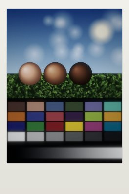

**Cold 100** (`folding-instant/cold`)

- **Aiming for:** Cold, dark, desaturated and moody, with crushed shadows. Use the flash.
- **Color:** exposure -0.35 stops, film curve: contrast 1.3, toe 0.2, shoulder 0.7, saturation 0.7, temperature -0.25, shadow tint -0.01 / 0 / 0.02, curves: master
- **Grain:** intensity 0.2, size 1, color 0.3, clumping 0, strength in shadows / mids / highlights 1 / 0.9 / 0.4
- **Lens:** soft edges 0.3, glow 0.1
- **Light:** vignette 0.25

 

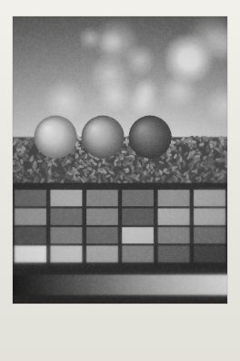

**B&W 3000** (`folding-instant/bw`)

- **Aiming for:** Black and white with lifted blacks and strong, coarse grain.
- **Color:** exposure -0.2 stops, film curve: contrast 1.2, toe 0.6, shoulder 0.6, fade 0.12, black and white (mix 0.3 / 0.59 / 0.11)
- **Grain:** intensity 0.55, size 1.4, color 0.3, clumping 0.8, strength in shadows / mids / highlights 1 / 1 / 0.6
- **Lens:** soft edges 0.3, glow 0.1
- **Light:** vignette 0.25

 

### Disposable

#### Fun Flash

Inspired by Kodak FunSaver · 2:3 picture · options: Light Leak (on), Date (on)

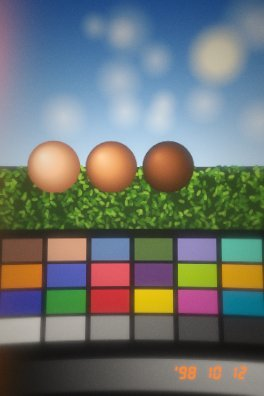

`fun-flash/default`

- **Aiming for:** Saturated and punchy, warm, pinched lens and strong vignette.
- **Color:** exposure +0.1 stops, film curve: contrast 1.25, toe 0.5, shoulder 0.6, saturation 1.2, temperature +0.32, fade 0.04, highlight rolloff 0.5, hue bands: red sat +0.1; yellow sat +0.1, highlight tint 0.03 / 0.01 / -0.03
- **Grain:** intensity 0.35, size 1.4, color 0.4, clumping 0.3, strength in shadows / mids / highlights 1 / 0.9 / 0.4
- **Lens:** pincushion distortion 0.35, soft edges 0.4, glow 0.3
- **Light:** flash 0.5, vignette 0.35, light leak 0.35 on 60% of shots, varies ±0.3 stops and ±0.15 warmth per shot

 

#### Snap 27

Inspired by Fujifilm QuickSnap · 2:3 picture · options: Light Leak (off), Date (on)

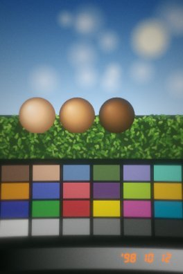

`snap-27/default`

- **Aiming for:** Nostalgic daylight disposable: sometimes overexposed, soft green undertones, yellowish skin.
- **Color:** exposure +0.1 stops, film curve: contrast 1.2, toe 0.6, shoulder 0.5, saturation 1.1, temperature +0.05, tint -0.12, fade 0.04, highlight rolloff 0.5, hue bands: orange hue +6°; green sat +0.1, shadow tint -0.02 / 0.02 / 0
- **Grain:** intensity 0.32, size 1.3, color 0.4, clumping 0.3, strength in shadows / mids / highlights 1 / 0.9 / 0.4
- **Lens:** pincushion distortion 0.25, soft edges 0.35, glow 0.25
- **Light:** flash 0.45, vignette 0.3, light leak 0.35, varies ±0.4 stops and ±0.1 warmth per shot

 

#### Simple 400

Inspired by Fujifilm Simple Ace · 2:3 picture · options: Date (on)

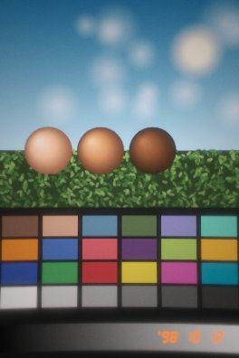

`simple-400/default`

- **Aiming for:** Warm, with pinkish whites, muddy yellows, cyan blues and cool greens.
- **Color:** film curve: contrast 1.2, toe 0.6, shoulder 0.6, saturation 1.05, temperature +0.25, fade 0.03, highlight rolloff 0.5, hue bands: yellow sat -0.3 lum -0.1; green hue +10° sat -0.1; blue hue -15°, highlight tint 0.02 / 0 / 0.015
- **Grain:** intensity 0.3, size 1.3, color 0.4, clumping 0.3, strength in shadows / mids / highlights 1 / 0.9 / 0.4
- **Lens:** pincushion distortion 0.2, soft edges 0.3, glow 0.2
- **Light:** flash 0.4, vignette 0.2, varies ±0.3 stops and ±0.1 warmth per shot

 

#### Party Flash

Inspired by Kodak Power Flash · 2:3 picture · options: Date (on)

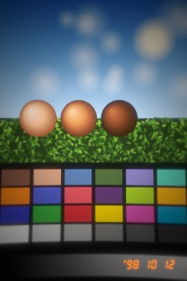

`party-flash/default`

- **Aiming for:** A bright, harsh flash that falls off fast into a dark vignette.
- **Color:** film curve: contrast 1.35, toe 0.4, shoulder 0.5, saturation 1.2, temperature +0.2, highlight rolloff 0.2
- **Grain:** intensity 0.3, size 1.3, color 0.4, clumping 0.3, strength in shadows / mids / highlights 1 / 0.9 / 0.4
- **Lens:** pincushion distortion 0.3, soft edges 0.3, glow 0.2
- **Light:** flash 0.9, vignette 0.5, varies ±0.25 stops and ±0.1 warmth per shot

 

#### B&W Snap

Inspired by Ilford XP2 single-use camera · 2:3 picture · options: Date (off)

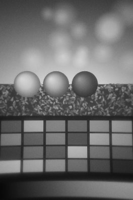

`bw-snap/default`

- **Aiming for:** Soft black and white from a plastic lens and a little flash.
- **Color:** film curve: contrast 1.25, toe 0.6, shoulder 0.6, fade 0.05, highlight rolloff 0.5, black and white (mix 0.3 / 0.59 / 0.11)
- **Grain:** intensity 0.35, size 1.3, color 0, clumping 0.4, strength in shadows / mids / highlights 0.9 / 1 / 0.5
- **Lens:** pincushion distortion 0.3, soft edges 0.4, glow 0.25
- **Light:** flash 0.5, vignette 0.4, varies ±0.25 stops and ±0 warmth per shot

 

<!-- looks:end -->

## References

### Used for this work

- **r/DazzCam, "My Dazzcam guide: every camera explained"** (app version 2.17.3, updated
  June 16, 2026), <https://www.reddit.com/r/DazzCam/comments/1tuyemk/my_dazzcam_guide_every_camera_explained/>.
  The model for the whole design: cameras as bundles of color profiles, aspect ratio,
  frames, lens effects and toggles. It is also the source of most cameras' target traits,
  e.g. "cool tones and deep rich blacks, lightens yellows" (Street D), "FX3-2: harsh
  contrast, highlights clip easily; FX3: murky turquoise shadows" (CCD 2004), "IR400:
  yellows and light greens turn pink, blues turn cyan" (Infrared), and "heavy pin-cushion
  distortion, vignetting, out-of-focus edges, teal and orange" (Holga).
- **Dazz Cam on the App Store**, <https://apps.apple.com/us/app/1422471180>: the camera
  categories and film formats the app offers.
- **"Dazz Cam cameras description"** (GitHub gist by hrchu),
  <https://gist.github.com/hrchu/f520b4b24579a205ba2d303c1811ea2f>: which real camera each
  Dazz camera models (e.g. CPM35 → Canon Sure Shot, S 67 → Pentax 67, Inst C → Instax
  Mini 8).
- **Dehancer, "Halation"**, <https://www.dehancer.com/learn/article/halation>, and
  **"Halation and its simulation in Dehancer"**,
  <https://blog.dehancer.com/articles/halation/>: halation as red-orange halos around
  bright sources and contrasty edges with a brightness threshold, which set our halation's
  color and `threshold`.
- **Dehancer reviews** (grain set per tonal range, bloom as a separate glow):
  <https://www.provideocoalition.com/review-dehancer-film-emulation-plugin/>,
  <https://photofocus.com/software/getting-the-film-look-in-after-effects-with-dehancer/>.
  These led to `grain.response` and the separate `bloom`.
- **iMore, "Huji Cam: the super popular new app that turns your photos into 1990s film"**,
  <https://www.imore.com/huji-cam-super-popular-new-app-turns-your-photos-1990s-film>: light
  leaks, grain, color shifts and the `'98` date stamp of disposable-camera apps.
- **Instax film sizes:**
  - Wikipedia, <https://en.wikipedia.org/wiki/Instax>: Instax Mini 54×86 mm print, 46×62 mm
    picture.
  - Fujifilm, <https://fujifilm.com/us/en/consumer/instax/film/square/white-2-pack>: Instax
    Square 86×72 mm print, 62×62 mm picture.
- **Polaroid photo dimensions**,
  <https://support.polaroid.com/hc/en-us/articles/115012363647-What-are-Polaroid-photo-dimensions>:
  the instant-white frame.
- **Film perforations** (Wikipedia), <https://en.wikipedia.org/wiki/Film_perforations>, and
  **SMPTE ST 139** (35 mm perforation dimensions),
  <https://pub.smpte.org/doc/st139/20031112-pub/st0139-2003.pdf>: KS perforations are
  2.794×1.981 mm; 135 film uses the 4.75 mm long pitch; film width 34.975 mm.
- **ColorChecker** (Wikipedia), <https://en.wikipedia.org/wiki/ColorChecker>, and BabelColor,
  <https://babelcolor.com/colorchecker-2.htm>: the sRGB values of the 24 patches in the test
  scene.
- **sRGB** (Wikipedia), <https://en.wikipedia.org/wiki/SRGB>: the transfer functions used in
  the shaders and the LUT (IEC 61966-2-1).
- **F. N. Fritsch and R. E. Carlson, "Monotone Piecewise Cubic Interpolation,"** _SIAM Journal
  on Numerical Analysis_ 17(2), 238–246, 1980; summary at
  <https://en.wikipedia.org/wiki/Monotone_cubic_interpolation>: the tone curves.
- **Rodrigues' rotation formula** (Wikipedia),
  <https://en.wikipedia.org/wiki/Rodrigues%27_rotation_formula>: hue shifts as rotations
  around the gray axis.

### Background reading

These describe the films the profiles are named after; their curves were not used
numerically.

- Kodak Portra 400 technical data sheet (E-4050),
  <https://www.freestylephoto.com/static/pdf/product_pdf/kodak/e4050_Kodak_Portra_400.pdf>.
- CineStill 800T and its missing anti-halation (remjet) layer, which causes red halos:
  <https://analog.cafe/r/cinestill-800t-film-review-dske> and Dehancer's profile,
  <https://dehancer.com/profiles/film/cinestill-800t>.
- MDN on the browser APIs the viewfinder uses:
  `requestVideoFrameCallback`,
  <https://developer.mozilla.org/en-US/docs/Web/API/HTMLVideoElement/requestVideoFrameCallback>,
  and `ImageCapture.takePhoto`,
  <https://developer.mozilla.org/en-US/docs/Web/API/ImageCapture/takePhoto>.
